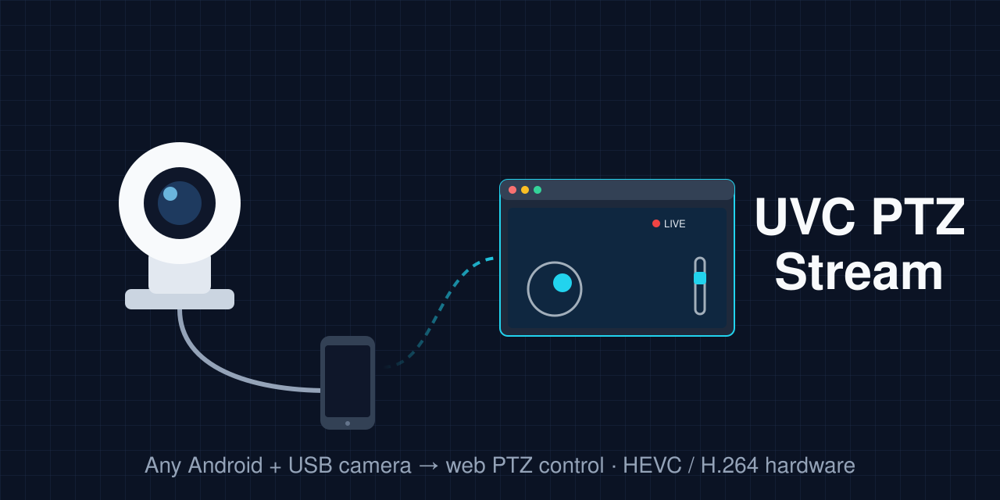

# UVC PTZ Stream



Turn any Android device with a USB host port (phone, tablet, TV box) into a web-controlled
PTZ camera server. Plug in a USB (UVC) PTZ camera, open `http://<device-ip>:8080` from any
browser on the network, and you get live video plus pan / tilt / zoom control.

- **Video**: MJPEG always; **hardware H.265/HEVC** when the device has an HEVC encoder
  (e.g. Rockchip VPU), otherwise **H.264** (hardware when available). Decoded in the browser
  with WebCodecs, with automatic fallback to MJPEG. Adaptive bitrate per client congestion.
- **PTZ**: analog joystick + zoom lever (mobile-first UI, fullscreen in landscape),
  tap-to-center on the video, saved presets with an automatic tour.
- **Image**: the UVC controls the camera exposes, plus software brightness/gamma with an
  optional software auto-exposure (useful when the camera firmware ignores exposure controls).
- **Always on**: starts at boot, foreground service, restarts if killed; a watchdog reopens the
  camera if it disappears and stops the stream after 3 minutes without viewers.
- **Access control** (optional): when exposed through Cloudflare Access, per-email permissions
  and a live "who is connected" list. LAN clients are trusted as admin.
- **Home Assistant** (optional): buttons to toggle `switch.*` entities from the UI.

No root needed. On rooted devices the camera is opened without the USB permission dialog.

## Requirements

- Android 7.0+ (API 24), ARM 64-bit or 32-bit, with **USB host (OTG)**.
- A **UVC** camera. Developed and tested with a motorized PTZ camera that reports itself as
  `045e:8888 "USB3.0 FULL HD PTZ"` (YUY2 only); other UVC cameras with standard
  pan/tilt/zoom controls should work. The first UVC device found is used.
- **USB 2.0 and USB 3.0** are both supported:
  - USB 2.0 (480 Mbit/s): up to 720p with uncompressed YUY2 cameras. Most stable.
  - USB 3.0 (5 Gbit/s): needed for 1080p YUY2. Requires a healthy SuperSpeed link (good cable,
    powered hub if needed). If the link resets under load (`error -110` in the kernel log), move
    the camera to a USB 2.0 port or hub.
- Phones: use an OTG adapter, and a powered OTG hub if the camera draws power from USB.

## Build

Works the same on Linux and on Windows (Git Bash). No IDE needed.

```bash
./build.sh                 # build app/build/outputs/apk/debug/app-debug.apk
./build.sh 192.168.1.50    # build + install over network adb (port 5555) + start
```

`build.sh` finds the Android SDK (`ANDROID_SDK_ROOT`/`ANDROID_HOME`, `./android-sdk`,
`~/Android/Sdk`, `%LOCALAPPDATA%/Android/Sdk`), writes `local.properties`, fetches and patches
`libusb` + `libuvc` through `./setup-native.sh` on the first run, and builds with the Gradle wrapper.

Needed: JDK 17+, Android SDK with `platforms;android-34`, `build-tools;34.0.0`,
`ndk;26.1.10909125`, `cmake;3.22.1`, `platform-tools`.

With a USB cable instead of network adb: `adb install -r app/build/outputs/apk/debug/app-debug.apk`.

## First run

1. Install and open the app, grant the **Camera** permission (Android requires it for UVC devices).
2. Plug in the camera and accept the **USB permission** dialog (tick "always open"). Rooted devices
   skip this.
3. Open `http://<device-ip>:8080` in a browser.

For an always-on setup, disable battery optimization for the app
(`adb shell dumpsys deviceidle whitelist +com.h96.hwstream`).

## Optional configuration

Add to `local.properties` (never committed) before building:

```properties
# Cloudflare Access: this email is always admin and cannot be blocked
admin.email=you@example.com

# Home Assistant light buttons
ha.url=http://homeassistant.local:8123
ha.token=<long-lived access token>
ha.lights=Living room=switch.living_room;Desk lamp=switch.desk_lamp
```

Everything is optional: without it the access control still works (LAN = admin) and the lights
section is empty.

## Remote access

The app speaks plain HTTP on port 8080. To reach it from outside the LAN, put it behind a
tunnel with authentication, for example Cloudflare Tunnel + Cloudflare Access. The app reads
the `Cf-Access-Authenticated-User-Email` header to identify users. Do not expose port 8080
directly to the internet.

## How it works

```
UVC camera --USB--> UsbManager fd (or root fd) --> libuvc (single owner of the device)
   --> YUY2 frames --> software luma LUT --> JPEG  --> MJPEG  /stream/mjpeg
                                         --> NV12  --> MediaCodec HEVC/H.264 --> /video WebSocket
   --> PTZ and image controls on the same handle  <-- /ws WebSocket (joystick)
```

On rooted devices the kernel `uvcvideo` driver is unbound first, so the Android camera service
does not compete for the camera.

## HTTP API (short)

- `/` web UI, `/ws` PTZ WebSocket, `/video` encoded video WebSocket
- `/stream/mjpeg`, `/stream/snapshot.jpg`, `/stream/start?w=&h=&fps=`, `/stream/stop`,
  `/api/stream/stats`, `/api/stream/formats`
- `/ptz?op=pan_left|pan_right|tilt_up|tilt_down|zoom_in|zoom_out|home|stop`
- `/api/ptz/limits`, `/api/ptz/pos`, `/api/controls`, `/api/control/set?id=&value=`
- `/api/luma?gain=&gamma=&ae=0|1`
- `/api/access/whoami`, `/api/access/list`, `/api/access/set` (admin)
- `/api/debug` (diagnostics, requires the `system` permission)

## Device-specific extras

The project started on an H96 Max V56 TV box (RK3566, Android 12). A few files only do something
there and are harmless elsewhere: `LedControl.kt` (front LED) and `VfdControl.kt` (front display
diagnostics). The UI is in Italian.

## License

MIT, see [LICENSE](LICENSE). At build time the project downloads and statically links
[libusb](https://github.com/libusb/libusb) (LGPL-2.1) and [libuvc](https://github.com/libuvc/libuvc)
(BSD-3-Clause); their licenses apply to those parts.
